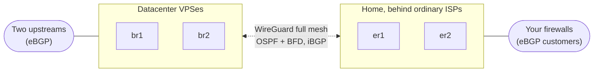
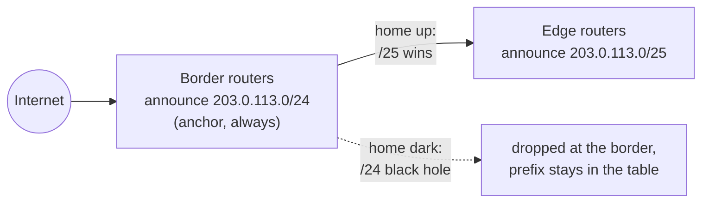
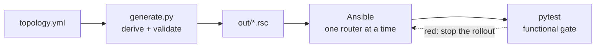

# mikrocosm

**Run your own autonomous system from home on MikroTik, described in one YAML file.**

A config generator, deploy pipeline and test suite for a small but real dual-stack BGP
network. One public ASN. A provider-independent IPv4 /24 and IPv6 /40. Two cheap datacenter
VPSes running RouterOS CHR as border routers, and two edge routers at home behind ordinary
residential connections. CGNAT included.

You write `topology.yml`. `generate.py` derives every address, port, key and filter from it,
refuses anything inconsistent and renders complete RouterOS v7 scripts. Ansible rolls them out
one router at a time behind health gates. Then pytest checks the live network does what the
YAML says.

> Every number here comes from the documentation ranges: AS64500, `203.0.113.0/24`,
> `198.51.100.0/24`, `192.0.2.0/24`, `2001:DB8::/32` and `example.net`. The example topology
> renders out of the box. Swap in your own values before you deploy anything.

## The shape of it

Two routers in a datacenter, two at home and WireGuard between all four. Home doesn't need a
public address. It dials out.



The borders announce the whole `/24` all the time. Home announces only the `/25` it's actually
attached to. Longest-prefix-match picks home whenever home is up, and the internet never
notices when it isn't:



Nobody types config by hand:



The full wiring diagram with every tunnel and port is in
[docs/README.md](docs/README.md#the-full-picture). Bring coffee.

## Scope and honesty

If you've ever wanted a home network with its own line in the global routing table, welcome.
Your family won't get it and that's okay.

This runs one real network. It targets RouterOS 7 (tested on 7.24 and 7.25), assumes two
border and two edge routers, and has opinions about almost everything. Treat it as a working
reference. Not a turnkey product. Read the generated `.rsc` before you import it because the
deploy primitive is `reset-configuration`.

## What you get

- **Border routers in datacenters originate your prefixes.** A home power cut doesn't
  withdraw you from the internet. An anchor route and a guard script withdraw only when nobody
  in the AS can deliver ([docs/origination.md](docs/origination.md)).
- **A full WireGuard mesh** between every router. NAT-piercing, pinned per WAN, no public
  address needed at home ([docs/wireguard.md](docs/wireguard.md)).
- **OSPFv2 + OSPFv3 with BFD** for sub-second liveness. WAN preference is just cost
  ([docs/ospf.md](docs/ospf.md)).
- **Full-mesh iBGP on loopbacks** with separate v4 and v6 sessions ([docs/ibgp.md](docs/ibgp.md)).
- **eBGP customers** (pfSense, UniFi, anything that speaks BGP) that claim VIPs or carve up
  delegated blocks. The grant in YAML is the security boundary. For UniFi gateways the
  generator writes the customer's FRR config too.
- **Traffic engineering, RTBH and large communities** ([docs/traffic-engineering.md](docs/traffic-engineering.md),
  [docs/communities-rtbh.md](docs/communities-rtbh.md)).
- **External peering** in three realms: the internet, isolated bilateral VRFs and DN42.
- **SNMPv3-only monitoring** with credentials generated into a gitignored keystore
  ([docs/snmp.md](docs/snmp.md)).
- **Remote sites.** One hAP-class router joins the mesh and gets a delegated /29 and /48.
- **AWS BYOIP / BYOASN tooling** for taking part of the space to AWS (`aws/`).
- **A pipeline that's allowed to say no.** Validation before rendering, ~250 hermetic unit
  tests, a per-router functional gate, end-to-end checks and a manual chaos playbook
  ([docs/netdevops.md](docs/netdevops.md)).

## Quick start

Needs Python 3.12+. `wg` (WireGuard tools) is optional, for key generation.

```bash
git clone https://github.com/<you>/mikrocosm.git
cd mikrocosm
./demo.sh            # render the example topology offline into out/
ls out/              # br1.ord1.rsc, er1.hdc.rsc, manifest.json, inventory.yml, ...
```

`demo.sh` is the real build with the two network fetches (SSH keys and management prefixes)
swapped for a placeholder. No network needed. Once you have your own topology:

```bash
./build.sh --check   # validate only, writes nothing
./build.sh           # render for real; fetches keys_url and mgmt_prefixes_url
```

Run the tests:

```bash
python3 -m venv .venv && .venv/bin/pip install -r requirements-dev.txt
.venv/bin/pytest     # unit suite: hermetic, no network, no hardware
```

## Make it yours

1. Copy `topology.yml` and replace the ASN, prefixes, domain and provider details. The
   comments in that file are the schema docs. Get something wrong and the generator usually
   tells you what to do about it.
2. Replace the `CHANGE-ME-*` values with your upstreams' TCP-MD5 passwords. Point
   `ssh.keys_url` and `mgmt_prefixes_url` at endpoints you control. Paste your CI runner's
   public key into `automation.keys` or delete that block.
3. Read [docs/generator.md](docs/generator.md) for the build, the three trust levels of files
   and how to apply a config. [docs/chr-vps-guide.md](docs/chr-vps-guide.md) covers standing up
   a CHR on a VPS.
4. Deploy with `ansible-playbook ansible/deploy.yml` ([ansible/README.md](ansible/README.md))
   or wire up the included GitLab pipeline.

**Secrets never go in git.** `keys.json` (WireGuard keys, PSKs, SNMP passphrases) and
everything in `out/` hold private keys and are gitignored. `topology.yml` is meant to be
committed.

## Repository map

| Path | What it is |
|---|---|
| `topology.yml` | The single source of truth, as a fully worked example |
| `generate.py`, `emit.py` | Derive, validate, render. Emit manifest, inventory and pipeline |
| `templates/` | The RouterOS config itself (`br`, `er`, `site`) plus the UniFi FRR peer |
| `ansible/` | Deploy, upgrade and chaos playbooks |
| `tests/unit/` | Hermetic suite that gates every change |
| `tests/functional/` | Live gate that SSHes to routers after each deploy |
| `.gitlab-ci.yml`, `ci/` | Parent pipeline and the generated per-router rollout |
| `aws/` | ARIN + AWS BYOIP / IPAM onboarding scripts |
| `deploy.sh` | Publishes the generated DNS records to Route 53 |
| `docs/` | How the network works, layer by layer |
| `AD-LOG.md` | The decision log. Why it's built this way, mistakes included |

## Documentation

Start with [docs/README.md](docs/README.md) for how it works, then [AD-LOG.md](AD-LOG.md) for
why. The decision log is long on purpose. It keeps the losing options and the outages behind
each lesson so nobody simplifies them back in.

## Contributing

Issues and PRs welcome. See [CONTRIBUTING.md](CONTRIBUTING.md), and
[SECURITY.md](SECURITY.md) for reporting vulnerabilities.

## License

[MIT](LICENSE)
