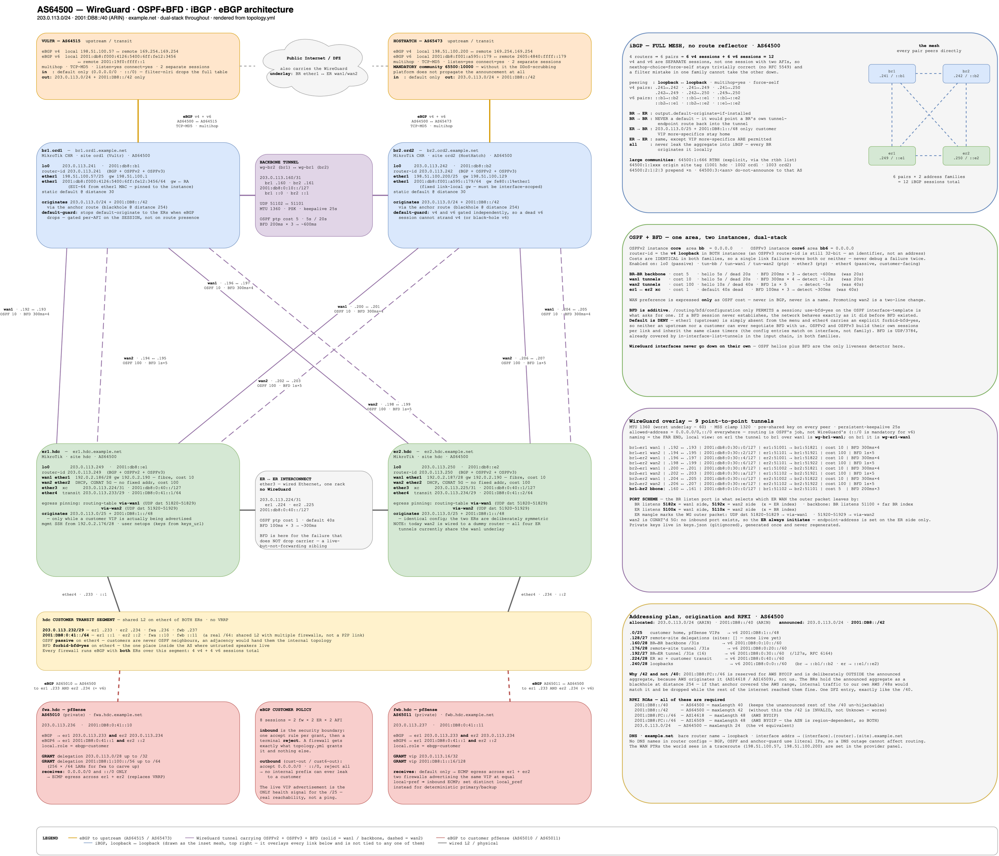

# AS64500: how the network works

The layered stack that turns two datacenter VPSes and a home connection into a self-hosted
multi-homed `203.0.113.0/24`.

Two companion documents:

- [`AD-LOG.md`](AD-LOG.md) is the **decision log**. *Why* each choice was made, what it beat
  and the failure that justifies it. These docs say "we do X". The AD-LOG says "we do X instead
  of Y because Z."
- [`generator.md`](generator.md) covers the **config generator**. `topology.yml` → `generate.py` →
  `out/*.rsc`, and how to render and apply a config.

These docs describe the *system*. The config that implements it comes from
[`templates/br.rsc.j2`](../templates/br.rsc.j2), [`templates/er.rsc.j2`](../templates/er.rsc.j2)
and [`templates/site.rsc.j2`](../templates/site.rsc.j2).

---

## The one-paragraph version

Two **border routers** (BRs) sit in datacenters, each with its own eBGP upstream. Together they
originate the `/24` to the internet all the time, home up or not. Two **edge routers** (ERs) sit
at home and advertise only the `/25` of customer space attached to them. **WireGuard** tunnels
glue every router to every other. **OSPF** runs over those tunnels and it's the *only* thing that
detects a dead link. **iBGP** runs in a full mesh over loopbacks and carries the actual prefixes,
with next-hops resolved through OSPF. Longest-prefix-match does the rest. The ERs' `/25` beats the
BRs' `/24` whenever home is reachable. When it isn't, traffic falls into a black hole at the BRs
and the `/24` in the global table never moves.

A lot of machinery for one `/24`. That's the fun part.

---

## The full picture

Every router, tunnel, transit link and customer on one canvas. It's dense on purpose. This is
the map you reach for when debugging, not the one you show at dinner. Edit
[`architecture.drawio`](architecture.drawio) and re-export the PNG. The PNG carries its own
source so either file opens in draw.io.

---

## The layered stack

Each layer depends only on the one below. Read them in order.

| Layer | Doc | What it does |
|---|---|---|
| **0 · Underlay** | [wireguard.md](wireguard.md) | Encrypted tunnels between every router. NAT-piercing, WAN-pinned, post-quantum-hardened. The wires. |
| **1 · IGP** | [ospf.md](ospf.md) | Liveness and internal reachability. The *only* thing that notices a dead tunnel, in hundreds of milliseconds with BFD under it. WAN preference is cost. |
| **2 · iBGP** | [ibgp.md](ibgp.md) | Carries the customer prefixes across the AS. Full mesh with next-hops resolved via OSPF. |
| **3 · Origination** | [origination.md](origination.md) | How the `/24` gets into the world and stays there. The anchor route, `/25` vs `/24` and `anchor-guard`. |
| **3 · eBGP** | [ibgp.md#the-edge-ebgp](ibgp.md#the-edge-ebgp) | The two upstream sessions and the default route they bring in. |
| **4 · Traffic engineering** | [traffic-engineering.md](traffic-engineering.md) | Choosing *between* the upstreams. Egress by local-pref, ingress by AS_PATH prepending. Two choices, two mechanisms, both optional. |

Cross-cutting references:

- [addressing.md](addressing.md): the address plan and the role-based naming convention.
- [addressing-v6.md](addressing-v6.md): the `2001:DB8::/40` plan. Same naming, opposite scarcity
  assumption. A `/48` per site, `/127` P2P links and AWS BYOIP space reserved up front.
- [communities-rtbh.md](communities-rtbh.md): internal large communities, upstream communities and remote-triggered black-holing.
- [failure-modes.md](failure-modes.md): every failure walked end to end. **Debugging an outage? Start here.**
- [traffic-engineering.md](traffic-engineering.md): the `te:` flags and `bgp_multipath`. Prefer a
  border router for ingress, egress, both or neither.
- [snmp.md](snmp.md): SNMPv3 for the Zabbix poller. authPriv, read-only, one source list, and the
  honest limits of what SNMP knows about a BGP router.
- [netdevops.md](netdevops.md): how a `topology.yml` change reaches the routers. The GitLab
  pipeline, the per-router test gate and the end-to-end check from behind the customer
  firewalls. **The layers above describe the network. This one describes how it changes.**

---

## The one principle

> **Every router advertises what's attached to it. The BRs originate the aggregate
> unconditionally. Longest-prefix-match does the rest.**

- The ERs are attached to home customer space so they advertise `203.0.113.0/25`.
- A remote site's router is attached to that site's `/29` so it advertises the `/29`.
- The BRs aren't attached to anything in particular. They originate the whole `203.0.113.0/24`
  from a black-hole "anchor" that keeps the AS visible even when everything behind it is dark.

No router advertises what it can't deliver. The one exception is the BRs' guarded black hole,
and it exists so the outside world never has to watch home flap.
