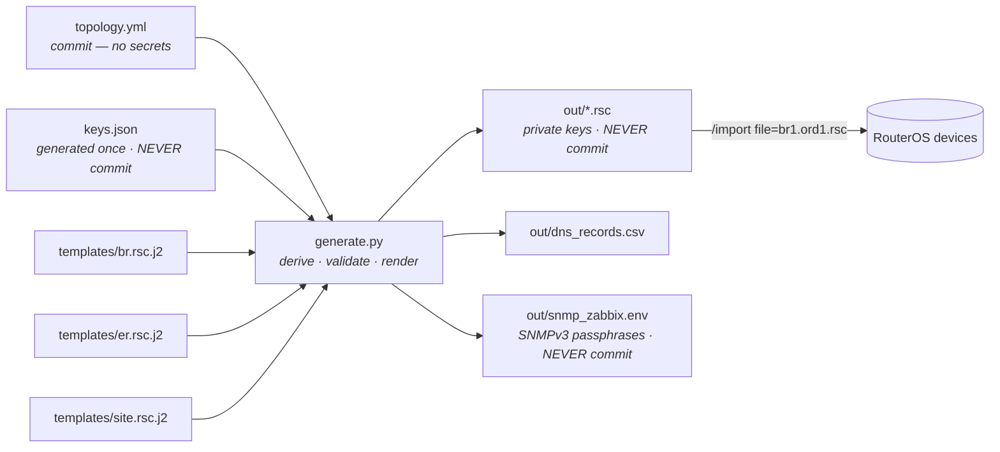
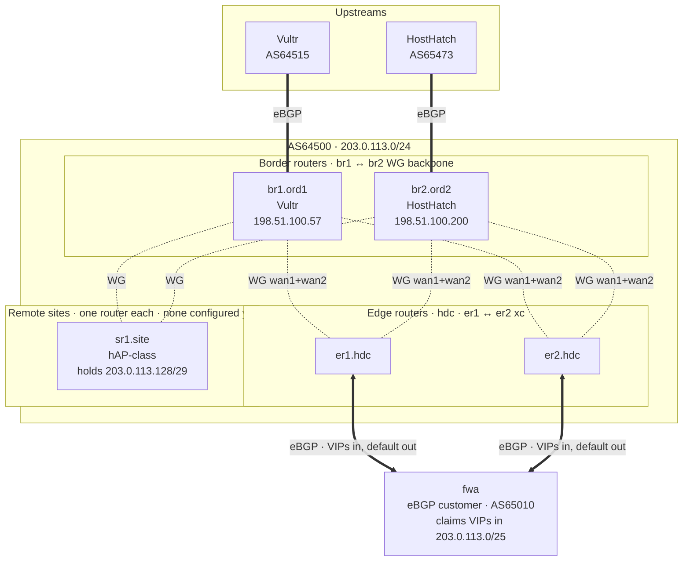

# The config generator, in depth

`topology.yml` is the single source of truth. `generate.py` renders it through the
Jinja templates in `templates/` into per-router RouterOS scripts. **The router config
itself lives in the templates, not here.** To know what a router actually does, read [`templates/br.rsc.j2`](../templates/br.rsc.j2),
[`templates/er.rsc.j2`](../templates/er.rsc.j2) and
[`templates/site.rsc.j2`](../templates/site.rsc.j2).

**How the network works** (the OSPF/iBGP/WireGuard stack, the anchor, failure behaviour) is in
[`docs/`](README.md). **Why it's built this way** is in [`AD-LOG.md`](../AD-LOG.md).

## Pipeline



```bash
./build.sh                 # generate. Reuses existing keys.
./build.sh --check         # validate topology, render nothing
./build.sh --rotate-keys   # DESTRUCTIVE. See below.
```

The build also writes three files that hold **no keys** and drive the deployment instead
of the routers: `out/manifest.json` (what the tests expect on each router),
`out/inventory.yml` (the Ansible inventory) and `out/pipeline.yml` (the GitLab rollout).
All three come from the same `topology.yml`, so adding a router grows the fleet, the tests
and the pipeline together. See [docs/netdevops.md](netdevops.md).

macOS or Linux. `build.sh` bootstraps a venv if `jinja2` / `pyyaml` / `cryptography`
are missing. Keygen uses `wg(8)` if it's installed. Otherwise the same clamped X25519
happens in Python.

## Deploying it — the pipeline

`git push` to `main` rolls the fleet. One router at a time in alternating
`br1 → er1 → br2 → er2` order. **Each router passes a functional test before the
next one gets touched.**

```bash
./build.sh
pytest                                   # unit: no keystore, no network, no hardware
pytest tests/functional                  # the functional gate, read-only, live fleet
pytest tests/functional --router br1.ord1 --focus br1.ord1

cd ansible
ansible-playbook deploy.yml              # roll what changed (prompts per router)
ansible-playbook chaos.yml               # break a live path, prove it fails over
```

Everything CI does is one of those commands. The pipeline adds ordering, gating and
secret handling. No behaviour you can't run by hand.

**Ansible orchestrates, pytest asserts.** Playbooks *change* things (upload, reset,
wait, reboot, restore) because ordering and retries are what Ansible's good at. The
checks are pytest because assertions want structured data and a JUnit report. The
probes read RouterOS over the same SSH the deploy uses (`:serialize to=json`). **Not**
the REST API. The templates disable `www`/`www-ssl`/`api`/`api-ssl` by name, and
turning one back on would add a listening service to a DFZ-facing router just to check
on it.

The gate is a GitLab `needs:` edge, not a check inside a script. `deploy:er1`
**needs** `verify:br1`, so a failing test means the next router's job never becomes
eligible. And the most important test doesn't run on a router at all. The runner sits
behind the customer firewalls so its own egress *is* the end-to-end path. The assertion:
**the address the internet sees is inside `203.0.113.0/24`**. That one HTTP GET proves
the return path. The prefix is in the DFZ, an anchor is up, an upstream carries it and
the tunnels deliver it home.

**No automatic rollback.** On purpose. The apply path is a destructive reset, so
rolling back means running the same destructive apply again on a box that just failed
to come back. The pipeline stops instead.

Full detail, including what the runner needs and which CI variables to set:
[docs/netdevops.md](netdevops.md).

## Applying a config to a device

The generated `out/*.rsc` is a **complete device config built entirely with
`add`**. It assumes a blank router. `/import` is additive and never removes what's
there. So importing onto a device that already has config (a previous partial import
counts) collides on the first entry that already exists:

```
Script Error: failure: already have such entry (/ip/firewall/address-list/add; line 21)
```

Don't import on top of a live config. **Reset to a bare config and run the script
fresh.** That's the clean, repeatable way:

```
# 1. Upload the .rsc to the router first (scp, or Files / WinBox drag-drop).

# 2. On the router:
/system/reset-configuration no-defaults=yes skip-backup=yes keep-users=yes run-after-reset=br2.ord2.rsc
```

Flags:

- `no-defaults=yes`: skip RouterOS's default firewall/DHCP/etc. so nothing exists
  for the script to collide with.
- `skip-backup=yes`: no auto-backup prompt.
- `keep-users=yes`: **keep your user accounts across the reset.** Without it you're
  back to the default `admin`/blank login and get to recreate your user.
- `run-after-reset=br2.ord2.rsc`: after the reset + reboot, run your script against
  the now-empty config.

**Do this with console / out-of-band access** (HostHatch VNC, see
[docs/chr-vps-guide.md](chr-vps-guide.md)). The reset drops all connectivity and you
won't get back in over SSH until the script re-creates SSH-on-mgmt. If the script errors
halfway, you're locked out of a box you can only reach via console.

> Really can't reset (need to stay reachable, no OOB)? Hand-clear the colliding tables
> before re-importing: `/ip/firewall/filter remove [find]`, `/ip/firewall/raw remove
> [find]`, `/ip/firewall/address-list remove [find]`, `/routing/bgp/connection remove
> [find]` and so on. Tedious and easy to miss a section. That's why reset wins.

If you ever hand-edit the templates: inside a RouterOS `source={ ... }` script block
variables are plain `$var`, **not** `\$var`. A backslash-escaped `$` is only valid inside
a double-quoted string. In a bare expression it's a syntax error
(`syntax error (line N column C)` pointing at the backslash).

## Network



A remote site is meshed to **every** BR just like an ER. No primary/backup pinning. It's
also the site's WAN router. The `/29` is attached to it and inside devices route directly
with no NAT and no customer eBGP session. See
[Adding a remote site](#adding-a-remote-site).

Every router runs **OSPF** over the tunnel /31s. It's the only liveness detector because WG
links never go down on their own. And a **full-mesh iBGP** over loopbacks: every router
peers with every other, no route reflector. WAN preference is *only* OSPF cost. Never BGP.
**BFD** sits under OSPF and cuts detection from tens of seconds to hundreds of
milliseconds. Additive, per link class, rolled out in two passes. It also runs **under the
eBGP sessions to the customer firewalls** where it swaps a 3-minute BGP hold time for
~900 ms. Opt-in per firewall, because this build doesn't write that far end (see [docs/ospf.md](ospf.md) and
[AD-LOG.md §19](../AD-LOG.md)). See the `bfd`, `ospf` and `bgp` sections of the templates.

---

## Why not a flat `.env`

Substitution isn't the hard part. **`br1`'s peer stanza needs `er1`'s *public* key and
`er1`'s needs `br1`'s.** A cross-reference graph over 18 keypairs (44 at 4 BRs) that has to
stay consistent on both ends of every tunnel. `envsubst` can't express that.

Same with addressing. /31s, listen ports and interface names are all **derived** from the
plan in §5 of the design doc, not listed. Hand-editing a `/31` means something went wrong.

`topology.yml` holds only what's truly irreducible, ~40 lines. Everything else falls out of
it and the shape of the rendered config lives in the templates.

---

## Three files, three trust levels

| File | Commit? | Notes |
|---|---|---|
| `topology.yml`, `generate.py`, `templates/`, `aws/onboard_aws.py` | **Yes** | No secrets. This is your source of truth. |
| `keys.json` | **Never** | Mode 0600. Generated once. **Back it up somewhere safe** — losing it means re-keying every tunnel. |
| `out/*.rsc` | **Never** | Contains private keys in plaintext. |
| `out/snmp_zabbix.env` | **Never** | Mode 0600. The SNMPv3 passphrases, in Zabbix's macro names. Written only when `snmp.enabled` is true. |
| `out/manifest.json`, `out/inventory.yml`, `out/pipeline.yml`, `out/pin.json` | Generated, **no secrets** | The pipeline's artifacts. No key material (`tests/unit/test_secrets.py` fails the build if that changes), which is why the deploy and test jobs can run without the keystore. Still in `out/` so still not committed. A generated file in git is a merge conflict waiting to happen. |
| `.env` | **Never** | ARIN API key, ASN, prefix, IPAM id. Read by `aws/onboard_aws.py`. |
| `aws/*.pem` | **Never** | The RSA key whose certificate is published in RDAP. **Back up `private-key.pem`** — AWS re-verifies against it on every provision. |

`.gitignore` enforces this. Verify with
`git check-ignore -v keys.json out/ .env aws/private-key.pem`.

`aws/` is the one directory holding secrets *and* code. It's ignored deny-by-default
(`aws/*`) with `!aws/*.py` allow-listed back in. A new key dropped in there gets ignored
without anyone remembering to update this file. Check a rename with `git add -An` before
you commit.

---

## Key generation is idempotent on purpose

**Re-running `./build.sh` never regenerates an existing key.** If it did, a second run would
quietly invalidate every peer on the network. Tunnels up, handshakes failing, nothing telling
you why.

Keys are identified by `{router-fqdn}:{interface}`. Add a BR to `topology.yml` and only its
new interfaces get keys; every existing tunnel is untouched.

`--rotate-keys` regenerates everything and backs up the old store to `keys.json.bak`. It's a
real outage. **Every** router must be reloaded before **any** tunnel works again. No partial
rollout.

---

## Validation runs before anything is written

`generate.py` refuses to render if it finds:

- a duplicate IP anywhere in the topology
- an address outside `203.0.113.0/24`
- duplicate WireGuard listen ports on one device
- both ends of a tunnel sharing a key
- `mss_clamp != wg_mtu - 40`
- `mss_clamp_v6 != wg_mtu - 60` (derived; only trips if `topology.yml` overrides it)
- a `provider_default_distance` outside `20 < d < 200`
- a remote site whose tunnels no longer fit `blocks.site_p2p` (a third BR does this)
- a remote-site `index` that is reused, out of range, or lands its `/29` outside
  `blocks.site_deleg`; a site `/48` outside `aggregate_v6`; a site WAN with an address but
  no gateway; a site with its WAN port bridged into the LAN
- a `te.prepend` outside `0..10`, a `te.local_pref` that is not an integer, an unknown key
  inside `te`, or either key set on *some* BRs and not all of them
- a `bgp_multipath` that is not `false` or an int in `2..16` — `true` is refused by name,
  because `multipath` is a count and `multipath=yes` aborts the import on the router
- an `origination.mode` other than `anchor` or `home`, `origination` written as a bare string,
  or an `origination.arm_guard` that is not a boolean
- a BFD combination that would ask for a session nothing can answer: `use_ospf` without
  `configure`, `bfd.customer` without `configure`, a firewall flagged `bfd: true` without
  `bfd.customer`, a `bfd.links` class that is not an `ospf_cost` class (or missing one), any
  interval × multiplier under ~50 ms, or `bfd: true` on a firewall whose *own* config this build
  renders while that renderer emits no BFD stanza
- an `snmp` block that would ship a weak or wide-open monitoring plane: `auth_protocol: MD5` or
  `encryption_protocol: DES` (refused by name, not merely "not in the set"), a source that is
  `0.0.0.0/0`, a v6 source (the v6 input chains carry no management hole and this would punch the
  first one), a still-`REPLACE-ME` or empty source list with `enabled: true`, a `contact` holding
  a quote or backslash, or `user: public` — the name of the default v1/v2c community the templates
  neutralise, which would have every router disable your own v3 user on import

Don't underestimate the MTU one. **Measure your worst underlay before you trust
`wg_mtu: 1360`.** 5G links often give you less than 1500. Every tunnel must use the same MTU
or a flow that fails over from wan1 to wan2 mid-stream blackholes. Binary-search it down with
a do-not-fragment ping to a BR's public before you commit the number.

---

## Adding a BR

```yaml
  - name:  br3
    site:  <site>
    index: 3
    provider:      <provider>
    wan_address:   <public IP>
    wan_prefix:    <netmask len, e.g. 24>   # static; ether1 never uses DHCP
    wan_gateway:   <provider gw>            # must be inside wan_address/wan_prefix
    static_default: true
    peer_address:  169.254.169.254
    peer_asn:      <THEIR ASN — check it>
    upstream_communities: []
    # Optional traffic engineering. If ANY border router sets one of these,
    # EVERY border router must set it -- including the losing value on the
    # preferred one. See docs/traffic-engineering.md.
    # te:
    #   prepend:    5     # ingress: extra copies of our ASN toward this upstream
    #   local_pref: 100   # egress:  what the ERs stamp on THIS BR's default
```

`./build.sh` then regenerates **every** router. The ERs gain two tunnels each, the existing
BRs gain a backbone link, and the full-mesh iBGP and `anchor-guard` peer lists grow on their
own. If the existing BRs carry `te:` blocks the build **fails** until the new one has them
too. That's the point. A third BR can't quietly land on defaults while the other two are being
steered. Only the new interfaces get new keys. `build()` in `generate.py` drives all that
fan-out and the loops in the templates consume it.

> **Vultr and HostHatch both peer at `169.254.169.254` with *different* ASNs** (64515 and
> 65473). The easiest thing in the build to get wrong. Symptom: a session stuck in `Active`
> with nothing in the log to explain it.

## Bringing the ASN and the /24 to AWS

`aws/onboard_aws.py` drives ARIN and AWS IPAM from `aws/.env`. Every step reads live
state first and skips itself if it's already done, so re-running after a failure or
timeout is safe. And some steps *will* time out. AWS takes up to a week to provision a
publicly advertisable range.

```bash
python3 aws/onboard_aws.py --status     # read-only. Start here.
python3 aws/onboard_aws.py --dry-run    # print every intended mutation, send none
python3 aws/onboard_aws.py              # run, prompting before each mutation
```

Everything AWS lives in `aws/`: the script, its `.env`, the RSA `private-key.pem` and
the `certificate.pem` published in RDAP. It shares nothing with `generate.py`.
`topology.yml` is that side's source of truth.

It stops once the ASN is **associated** with the CIDR. It never advertises.

### The ASN's RDAP comments cannot be automated

AWS verifies ownership by reading an X.509 certificate out of the **RDAP** record for
both the NET and the ASN. The NET half is scriptable. Reg-RWS exposes
`PUT /rest/net/{handle}` and the cert lives in `<comment>`. **The ASN half isn't.**
Reg-RWS has no ASN object at all. `/rest/asn/{asn}` 404s while `/rest/org/{handle}`
works with the same key, the published RNC schema has no ASN payload and the [methods list](https://www.arin.net/resources/registry/regrws/methods/)
has no ASN section.

The trap is `aut-num`. It *does* have a Reg-RWS payload and looks like the right object.
But it's an **IRR** object. It publishes to ARIN's IRR, not RDAP, and AWS never reads it.
Editing ASN public comments is
[ARIN Online](https://account.arin.net) only: *Modify ASN → Public Comments*,
one single long line including the `BEGIN`/`END CERTIFICATE` markers.

`--status` tells you whether the published cert matches `aws/certificate.pem`. If it
doesn't the script stops, because AWS signs with the local key and verifies against
the published cert.

### ROAs

BYOIP needs **two** ROAs over the /24. One for your own AS64500 (BYOASN requires it) and
one authorising Amazon's AS16509 and AS14618, `maxLength` /24 so IPAM can split the space
across Regions. The script creates the missing Amazon ones through
`POST /rest/rpki/{org}` and shows you each payload first.

They're created with `autoLink=false` on purpose. `autoLink=true` would have ARIN mint IRR
`route:` objects declaring Amazon an origin for your space. Untrue as long as AWS isn't
advertising.

Allow up to 24h for a new ROA to reach Amazon's validators.

### Before you ever advertise

BYOIP's minimum is a /24, and `203.0.113.0/24` is exactly what br1 and br2 already
originate (AD-LOG.md §2). Advertise from AWS too (under BYOASN, from AS64500, *the same
origin AS*) and the /24 is anycast for real.

That's not a knob in the design doc. It's a third originator `anchor-guard` can't see or
withdraw. §2's promise that the ERs' /25 beats the BRs' blackhole says nothing about a route
that never touches the WireGuard backbone. Think it through before you run
`advertise-byoip-cidr`.

### Undoing all of it

`--offboard` unwinds the onboarding in reverse dependency order. If you've advertised it
**withdraws the live announcement first**:

```bash
python3 aws/onboard_aws.py --offboard --dry-run   # preview the whole teardown
python3 aws/onboard_aws.py --offboard             # run it, prompting each step
```

The sequence is withdraw → disassociate ASN → deprovision CIDR → deprovision ASN → delete
pools → delete the two Amazon ROAs → remove the certificate from RDAP. The order is
enforced. AWS won't deprovision a CIDR an ASN is still associated with or delete a parent
pool while its child exists. And the Amazon ROAs go only **after** withdrawal so AWS's own
announcement is never left RPKI-invalid. Like onboarding, each step reads live state and
skips itself if done. The deprovision/delete calls are async, so re-run until `--status` is
clear.

Two things it will **not** do:

- **Delete the AS64500 ROA.** br1/br2 originate the /24 from it (AD-LOG.md §2). Remove it
  and your home network's RPKI validity breaks. Only the two Amazon ROAs the script
  created get removed.
- **Release your resources.** If an EIP, VPC or public IPv4 pool still holds space from the
  CIDR, deprovision can't proceed. The script lists the blocking allocations and stops so
  *you* decide what to tear down. Then re-run.

The ASN's RDAP certificate can't be cleared through the API for the same reason it couldn't
be added. No ASN object in Reg-RWS. So the script clears the NET record and points you at
ARIN Online for the ASN.

---

## Adding a remote site

A remote site is **one MikroTik router** (hAP-class) doing alone what `er1`+`er2` do as a pair
at home. A WireGuard tunnel to **every** BR, a seat in the full iBGP mesh and OSPF cost picking
the path. No `primary_br`/`backup_br`. Pinning a site to one border router would make its mesh
strictly weaker than an ER's and buy nothing.

It's also **the site's WAN router**. The `/29` is attached to it, it holds the first address as
the inside gateway and inside traffic routes directly. No NAT, no eBGP customer session, no VIP
claims. That machinery exists at `hdc` because `hdc` has firewalls carving up a shared `/25`. A
site owns its whole delegation.

```yaml
sites:
  - name:  sfo            # site code: 3-4 chars, no geography implied
    index: 1              # sequential, NEVER reused. Drives everything below.
    router: sr1           # optional; fqdn is {router}.{name}, default sr1
    wans:
      - id: wan1
        interface: ether1
        # address + gateway TOGETHER for a static ISP, or BOTH absent for DHCP
    lan_interfaces: [ether2, ether3, ether4, ether5]
```

`index` is the only number you pick. Everything else derives from it:

| Derived | site1 | site2 |
|---|---|---|
| fqdn | `sr1.sfo` | `sr1.pdx` |
| LAN delegation (`/29`) · inside gateway | `203.0.113.128/29` · `.129` | `.136/29` · `.137` |
| Loopback (v4 · v6) | `203.0.113.245` · `2001:DB8::51` | `.246` · `::52` |
| Site `/48` · LAN `/64` gateway | `2001:DB8:2::/48` · `::1` | `2001:DB8:3::/48` · `::1` |
| Tunnel `/31`s (one per BR) | `.176/.177`, `.178/.179` | `.180/.181`, `.182/.183` |
| BR listen port (`520xx` = site class) | `52021` | `52022` |

`./build.sh` then renders `out/sr1.sfo.rsc` **and** regenerates every other router. Each BR gains
a tunnel, an iBGP session and a `tun-site` interface list. Each ER gains an iBGP session. The
delegation lands in `anchor-guard`'s `customers` list on every BR by itself, and that's what lets
a live site hold `203.0.113.0/24` up while home is dark.

> **The v4 budget is four sites. Hard limit.** `blocks.site_p2p` is a `/28` (eight `/31`s) and
> each site reserves one per BR. Four sites × two BRs fills it exactly, which also happens to be
> the four `/29`s in `site_deleg`. **A third border router overflows it** and `generate.py`
> refuses to render instead of renumbering live links. The error names the options.

**The first apply has to happen at the site.** Ansible reaches a site router over its loopback,
and that doesn't exist until the config creating it is applied. So site #1 gets imported over
the LAN or the console (`/system/reset-configuration … run-after-reset=sr1.sfo.rsc`). After that
it's an ordinary inventory host. See the commented block in `ansible/inventory.yml`.

Two things about a site router that **aren't** true of anything else in the fleet. Both on
purpose, both called out in the generated config:

- **Its LAN interface sends Router Advertisements.** Every other interface in the AS is
  `advertise=no`. Here inside devices are meant to SLAAC out of the site `/64`.
- **It doesn't firewall the site.** The forward chain is empty like everywhere else, and the
  `/29` and the site `/64` are publicly routable. At `hdc` that's pfSense's job. At a site it's
  whatever the inside device is.

Related: if `mgmt_prefixes` (or what `mgmt_prefixes_url` returns) covers the site's `/29`, every
device on that client LAN is a management source for **every** router in the AS. The
`accept src-address-list=mgmt` rule sits above the terminal drop in each input chain. The build
warns when it spots this and the generated config repeats it.

---

## Adding a customer firewall

Append to `firewalls:` in `topology.yml`. Each firewall peers eBGP with **both** ERs over the
transit `/29` and gets space out of the home `/25` in one of two shapes. Use either, or both on
the same firewall:

```yaml
firewalls:
  - name:          fwa
    asn:           65010                 # private; must not collide with ours or an upstream's
    peer_address:  203.0.113.236       # on the transit /29, L2 with both ERs
    delegations:                         # a BLOCK it may carve up as it likes
      - prefix:  203.0.113.0/29
        max_len: 32

  - name:          fwb
    asn:           65011
    peer_address:  203.0.113.237
    allowed_vips:                        # exact prefixes, enumerated
      - 203.0.113.16/32
```

**`allowed_vips`** is a whitelist of exact prefixes. This prefix at this length, nothing else.
Use it when you know every address the firewall will ever claim and want the ER to enforce that
list literally.

**`delegations`** hands over a whole block. The firewall can advertise the block itself or any
more-specific down to `max_len` (default `32`) and the ER accepts whatever it picks without a
re-render. Use it when the firewall owns a range and you don't want to enumerate. A VIP added
behind `fwa` needs no change here.

Both compile to the same primitive, a prefix plus an accepted `dst-len` range. So the inbound
security filter, the er→br "stays home" filter and the `home-anchor-guard` liveness check all
treat them the same. **The inbound filter is the security boundary.** A firewall gets exactly
what's listed and every other advertisement is rejected. `max_routes` is derived from the
worst-case route count the grant allows (plus headroom) and becomes
`input.limit-process-routes-ipv4`. Set it in `topology.yml` to override.

The generator refuses to render if a grant falls outside the home `/25`, is the `/25` itself (a
firewall claims more-specifics, never the aggregate), overlaps the local-links block, uses a
non-private or colliding ASN or has a `peer_address` that duplicates another address in the
topology. Two firewalls granted the **same** prefix is how you get ECMP. Leave `local_pref`
unset on both. Set it differently on both for deterministic primary/backup. A partial set gets
rejected because RouterOS would quietly pair your value against its own default.

**`bfd: true`** puts BFD under that firewall's two eBGP sessions. A dead firewall gets noticed in
~900 ms instead of on the 3-minute BGP hold time, which "two firewalls claiming the same VIP"
needs to actually fail over. It needs `bfd.customer` timers (they render the permit on the ERs'
transit interface) and it's **per firewall** because this build doesn't write the far end.
Enable BFD there first, flag it here second and leave the other firewall on the old timers until
the first has survived a failure. Full rollout order in
[docs/ospf.md](ospf.md#bfd-toward-the-customer-firewalls).

### Generating the firewall's own config — `type:`

A customer session has two ends and this repo used to render only one. Add `type:` to a
firewall entry and it renders the **other** end too, from the same grant:

```yaml
  - name:          ucg
    asn:           65064
    type:          unifi                 # -> out/ucg.unifi.conf
    peer_address:  203.0.113.235
    allowed_vips:
      - 203.0.113.17/32
```

| `type` | Output | Notes |
|---|---|---|
| *(absent)* | nothing | The default. An ordinary customer whose config someone else writes. `fwa` and `fwb` are these. |
| `unifi` | `out/<name>.unifi.conf` | FRR format. UniFi's BGP *is* FRR; upload at **Settings → Routing → BGP**. Needs UniFi OS 4.1.13+ or UXG-Enterprise 4.1.8+. |
| `pfsense` | nothing, loudly | Recognised, renderer not written yet. The build says so and renders everything else. |

A dialect this build *renders* must also render BFD before a firewall using it can set
`bfd: true`. `unifi` doesn't today, so the flag is refused there. Otherwise you'd get an ER
asking a generated peer for a session the peer was never told to answer. A `pfsense` peer has
no renderer at all, so its config and matching the flag are on the operator.

Anything else gets refused at build time. A typo'd `unfi` would otherwise leave an ER waiting
for a session whose other end was never built.

Convenience isn't the point. The grant already exists once in `topology.yml`. Hand-writing the
far end writes it a second time in a second syntax, and what breaks isn't a dead session. It's
a **live one carrying less than it should**. A VIP granted here and never advertised, or a LAN
advertised into a filter that drops it. Both look like "BGP is up" from either end. So the
generated file mirrors the ER exactly. Its outbound prefix-list is the `cust-in-<fw>`
whitelist. Its inbound prefix-list is the default route and nothing else (all `cust-out` will
send). And `maximum-paths` matches the ER count so the customer's egress actually ECMPs instead
of pinning to one ER.

An exact `allowed_vips` entry becomes a `network` statement. A `delegations` block becomes
`redistribute connected` filtered back down to the grant, so the customer can carve the block
into LANs without a change at either end. `out/*.conf` is the one output here with **no keys**.
It's meant to be handed to whoever runs the box.

Two things the file can't do for you. The VIP has to actually exist on the gateway (FRR only
advertises a `network` it can resolve in its own table). And UniFi needs a firewall policy
allowing TCP/179 **to the gateway itself** from the transit segment. The generated file's header
calls out both.

**`default_route: install | ignore`** decides who owns the gateway's default. `install` (the
default) has FRR install the ERs' default, ECMP across both. `ignore` refuses it inbound so the
gateway's own WAN manager keeps the default and the transit is just one more WAN. Use `ignore`
on UniFi if you want the transit in its failover/load-balance set. Otherwise FRR's default lands
in the kernel ahead of the per-WAN routes and every other WAN goes idle.

---

## Before you enable `anchor-guard`

[`templates/br.rsc.j2`](../templates/br.rsc.j2) renders the `anchor-guard` script and its
scheduler line. **The scheduler is commented out on purpose.** The comment block right above it
has the exact verification sequence. It proves the anchor route really gates origination
*before* you arm the timer. Run it as written.

Arm it with `origination.arm_guard: true` in `topology.yml`. Not by pasting the scheduler onto
the box, because the next `reset-configuration` deploy drops it. `origination.mode: home`
changes what the guard counts (only the home `/25` over the BR's own ER tunnels, 60 s) and adds
a second proof step to the same comment block. See
[docs/origination.md](origination.md#home-mode).

If the /24 is still advertised with the anchor disabled, `output.network-blackhole` didn't take.
**`anchor-guard` is a silent no-op** and every failure guarantee in the design doc is fiction.
The companion `default-guard` script (same template) has its own honest test in the same file.

---

## Things the generator cannot check for you

Hardware and provider facts, not topology. The generator can't see them so they're on you.
Where a fix belongs in the config the templates flag it inline.

- **`mgmt_prefixes`** in `topology.yml` gates SSH *and* winbox (both bound to it in both
  templates). Get it wrong and you're locked out. It's the committed floor. `mgmt-refresh` can
  add to it from `mgmt_prefixes_url` but can never remove an entry in this list.
- **`wan_gateway`** for br1 is a guess. Confirm the Vultr DHCP-assigned gateway.
- **RouterOS filter syntax** (`bgp-large-communities includes`, `set bgp-path-prepend`) is
  written against the ROS7 rule language in the `ebgp-out` chains of `br.rsc.j2`. Matcher
  names drift between releases. Test on one BR before pushing to four.
- **RTBH through HostHatch.** `ebgp-out`'s `set bgp-communities` is a *replace*, not an
  append. It'll clobber `65500:10000`. That's why the template re-states the provider community
  in the RTBH rule. Test it before you rely on it.
