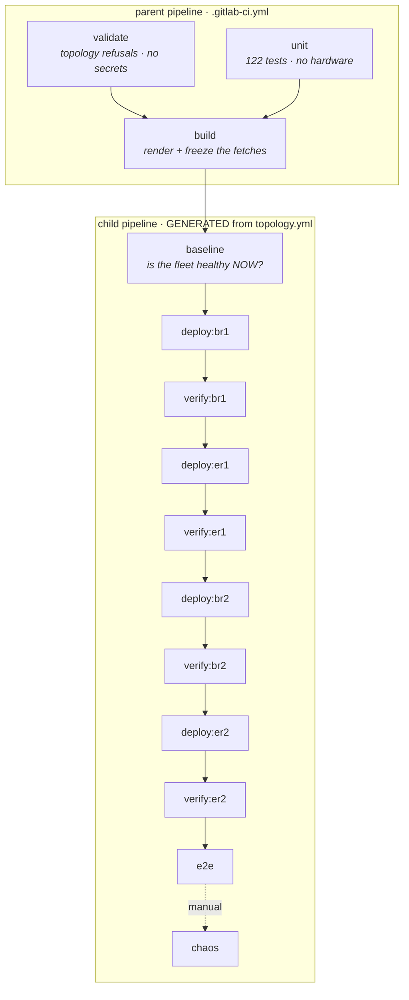

# The pipeline — build, deploy, test

How a change to `topology.yml` becomes a change to the routers, and what has to be true
before it's allowed to. The rest of [`docs/`](README.md) describes the network.

Short version: **merging to `main` rolls the fleet**, one router at a time. Every router
proves it still works before the next one gets touched.



---

## The three things that make this different from "a script in CI"

### 1. The pipeline is generated from the topology

Nobody writes `out/pipeline.yml` by hand. [`emit.py`](../emit.py) derives it from the same
`build()` output that renders the routers, so the job list and the network can't disagree.

The rollout **order is the whole point**. Border and edge routers alternate
(`br1 → er1 → br2 → er2`) so one BR and one ER are up at every step and the `/24` anchor and
the `/25` are never both dark at once. Hand-write that list and a third border router lands
wherever somebody appended it. Nothing complains.

Add a router to `topology.yml` and the pipeline grows a `deploy` job, a `verify` job and a
`needs:` edge in the right place with the right expectations. Nobody edits YAML.

The job *bodies* stay committed in [`ci/child-jobs.yml`](../ci/child-jobs.yml). Generated YAML
gets skimmed. The shell that resets a live border router shouldn't live in the skimmed part.

### 2. The gate is a DAG edge, not a check inside a script

`deploy:er1` **needs** `verify:br1`. If br1's tests fail the job that would touch er1 never
becomes eligible. No code path skips it, no flag bypasses it, and there's no line where a
stray `|| true` could sneak in.

It replaced a `pause:` prompt that asked a human to press ENTER before each router. The prompt
only asked whether you'd looked. The tests actually check.

### 3. Private keys never enter the artifact store

`out/*.rsc` hold WireGuard private keys. Passing them between jobs would copy them into
GitLab's artifact store. There they sit for the expiry window and anyone with project access
can download them.

So they're never artifacts. The deploy jobs **re-render** from the same commit. That's safe
because two properties hold and both get asserted on every merge:

- the generator is deterministic: same topology, same keystore, byte-identical output
  (`tests/unit/test_determinism.py`)
- the build job **pins** the two URLs `generate.py` fetches at render time into
  `out/pin.json` and every later job replays them

The second one is sneaky. `generate.py` fetches the management SSH keys and the
`mgmt_prefixes` endpoint *while rendering*. Fine when one person renders and applies right
away. Not fine when a pipeline renders in one job and deploys in another. The second render
can legitimately get a different answer and then the config that ships isn't the config that
passed. Both renders are correct on their own and nobody would ever notice.

`--pin` / `--use-pin` closes that. Every rollout job diffs its re-render against the build
job's output before touching anything:

```
Re-render matches the tested build.
```

The artifacts that *do* travel (`manifest.json`, `inventory.yml`, `pipeline.yml`,
`pin.json`) hold no key material. `tests/unit/test_secrets.py` fails the build if that ever
changes.

---

## What the builder gained

| File | What it is | Why it is generated |
|---|---|---|
| `out/manifest.json` | What the functional tests expect on each router: session names, peer addresses, adjacency counts, anchors, customer grants | Tests assert against the topology instead of hardcoding a fleet that was true when they were written |
| `out/inventory.yml` | The Ansible inventory | Every field derives from the role. `ansible_host` (the address for a control node **inside** the AS: a BR's loopback, an ER's transit address), `bootstrap_host` (the failsafe that doesn't need the overlay: a BR's provider WAN) and `router_role` |
| `out/pipeline.yml` | The GitLab child pipeline | See above |
| `out/pin.json` | The two build-time fetches, frozen | See above |

New `generate.py` flags:

```bash
python3 generate.py --check --json          # machine-readable validation
python3 generate.py --keys /tmp/k.json      # a throwaway fleet, for tests
python3 generate.py --out /tmp/render       # render anywhere
python3 generate.py --topology other.yml    # validate a mutated topology
python3 generate.py --pin out/pin.json      # record the fetches
python3 generate.py --use-pin out/pin.json  # replay them; no network at all
```

`--topology` / `--keys` / `--out` let a test render a **mutated** fleet with a throwaway
keystore into a temp directory. Without them the only way to test the validator is editing the
real `topology.yml`. Nobody runs a test suite that has to do that.

> **`ansible/inventory.yml` is gone.** It was hand-maintained and duplicated `ansible_host`
> and `router_role` for every router. The exact drift this repo exists to remove. `ansible.cfg`
> now points at `../out/inventory.yml`. Operational variables (SSH options, timeouts,
> `router_user`) moved to `ansible/group_vars/all.yml`, which is committed. They're decisions
> about driving a rollout, not facts about the topology. Generate them and a hand-tuned timeout
> lands in a file the next build overwrites.

---

## Ansible orchestrates, pytest asserts

This split runs through everything below. It answers "should this be Ansible or a script?":

| | Does what | Why |
|---|---|---|
| **Ansible** (`deploy.yml`, `chaos.yml`, `upgrade.yml`, `upgrade-npk.yml`) | **Changes** things: upload, reset, wait for SSH to drop and return, reboot, fingerprint, disable, restore | Ordering, retries and rollback are what it's good at |
| **pytest** (`tests/`) | **Checks** things | Assertions want structured data, fixtures and a JUnit report GitLab renders per check |

A failure now reads `test_ospf_adjacencies_are_full[br2.ord2]` in GitLab's test tab. Which
router, which check. Not a wall of playbook output.

### Why not the RouterOS REST API

RouterOS 7 has one and for a greenfield tool it'd be the obvious pick. Here it's the wrong one:

- **It's a listening service the templates disable by name.** `/ip/service` sets `www`,
  `www-ssl`, `api` and `api-ssl` to `disabled=yes` explicitly. REST needs `www-ssl` on. A new
  listener on a box whose `ether1` faces the DFZ, plus a self-signed cert to pin or ignore.
  Widening a router's attack surface just to check on it gets the priorities backwards.
- **The deploy path is SSH and SCP, full stop.** `scp` the `.rsc`, then
  `reset-configuration run-after-reset=`. The API would be a *second* transport with a second
  credential and a second ACL entry. And then you get tests that can't reach a router the
  deployment can.
- **You get the benefit without it.** `:serialize ... to=json` (7.13+, the fleet is on 7.24)
  turns any `print as-value` into JSON. Structured data over the transport that already exists.
  One round trip per router, no new service.

The whole snapshot is one SSH call emitting `@@section <json>` lines, each wrapped in
`:do {...} on-error={...}`. That trap is the important bit. An unknown property costs one section
and reports `PROBE-ERROR`. It doesn't return an empty list that every assertion downstream would
read as a dead network. *"I couldn't ask"* and *"the answer is none"* are different facts.

---

## The tests

### Unit — cheap, hermetic, gates every merge

No keystore, no network, no hardware. Runs on a fork's merge request. `pytest` with no arguments
runs exactly these.

| Module | What it proves |
|---|---|
| `test_validation.py` | Every refusal the README promises, asserted by breaking the **real** topology one field at a time |
| `test_determinism.py` | Two renders are byte-identical; existing keys are never regenerated |
| `test_crossref.py` | For every tunnel, the public key one end configures is **derived from the private key the other end holds** |
| `test_render.py` | The rendered `.rsc` won't brick a router |
| `test_probes.py` | The RouterOS probe is well-formed. Offline, in milliseconds |
| `test_secrets.py` | The CI artifacts contain nothing from the keystore |
| `test_manifest.py` | The inventory and the pipeline agree with the topology |

Three of those earn their keep more than the rest.

**`test_crossref.py`** is why this repo exists. The README says it: *"br1's peer stanza needs
er1's PUBLIC key, and er1's needs br1's."* The test parses both rendered configs, takes the far
end's **private** key, derives the public key with X25519 and checks it against what the near end
configured. It never asks the generator what the answer should be. `build()` agreeing with
`build()` proves nothing. And this failure is silent on the wire. The interface comes up, routes
install, OSPF sits in Init forever and no log on either box says "wrong key".

**`test_render.py`** exists because of how config gets applied. `reset-configuration` +
`run-after-reset` **wipes the box first** and then replays an add-only script. RouterOS stops at
the first line it rejects and skips everything after. One bad line isn't a config error. It's a
router with no firewall, no BGP and maybe no SSH, reachable only over the provider's VNC console.
So the test checks the *file*. No unrendered Jinja, no `multipath=yes`, customer whitelists
ending in a `reject`, anchors present as distance-254 blackholes and **management access
configured before anything that can fail**.

**`test_probes.py`** tests the test tooling. Sounds excessive until you see what happens
without it. A malformed probe returns *nothing* and every assertion downstream reports a healthy
network as dead. The rollout stops and the evidence points at the network. Both bugs it guards
against were real: a YAML fold that hid a newline inside a RouterOS command, and `blackhole=no`
(see below).

### Functional — per router, after it is deployed

`pytest tests/functional`, read-only, gating the next router. Every expectation comes from
`manifest.json` so nothing knows how many routers there are.

```bash
pytest tests/functional                              # the whole fleet
pytest tests/functional --router br1.ord1 --focus br1.ord1
pytest tests/functional -k mtu                       # one check, everywhere
```

1. **Did the import actually finish?** The log gets read for rejected lines. `deploy.yml`'s
   identity check only proves the script got to line 7. A router that failed on line 700 comes
   back, answers SSH, reports the right identity and has no BGP at all.
2. **WireGuard.** Every peer has handshaked. A tunnel interface shows *running* whether or not the
   far end ever answered. WireGuard has no link state. That's why OSPF sits on top of it.
3. **Peer keys match the intended peer** on the live box. A different claim from the rendered
   files agreeing. Catches a half-applied config or a manual edit.
4. **OSPF**, counted **per instance**, so per address family. `/routing/ospf/neighbor` returns v2
   and v3 in one table. Count the whole table and it passes with IPv6 OSPF completely dead.
5. **iBGP.** Every session **by peer address, not by count**. Two up and two down still counts as
   two, and which two is the whole question.
6. **eBGP.** The upstream (BRs) and every customer session (ERs).
7. **Customer routes.** At least one route installed from each granted block. An established
   session carrying nothing looks healthy from both ends.
8. **The anchors.** Present, with a loud note if one is withdrawn right now.
9. **Defaults.** v4 and v6, separately.
10. **The data plane.** Every other router's loopback, pinged from this one.
11. **The MTU, proved.** A DF packet of exactly `wg_mtu` must cross each tunnel and one byte more
    must **not**. The second half is the real test.
12. **BFD.** No session stuck down where `use-bfd` is armed.
13. **The fleet cross-check** (`--focus`). Every *other* router must still reach the one just
    deployed. A router can pass every check about itself while a peer can't reach it. A
    mismatched listen port does exactly that and only the peer knows.

### End-to-end: the one that counts

`tests/functional/test_e2e.py`. Runs after **every** router, not just at the end.

It runs **on the control node, not a router**. That's the whole design. The runner sits at hdc
*behind the customer firewalls* so its own egress crosses the entire stack without simulating any
of it:

```
runner → pfSense/UniFi → ER → WireGuard → BR → upstream → internet
                                                             │
   and back down the same stack, which only works if the ─────┘
   /24 is in the DFZ and somebody is originating it
```

**The source address the internet sees is inside `203.0.113.0/24`.** That proves the *return*
half of the path on its own. Traffic can leave through anything. It only comes back to our `/24`
if the prefix is globally routed, an anchor is up, an upstream carries it and the tunnels deliver
it home. A default that leaked in from somewhere else would still give you working internet. Just
with a different source address.

**A large TLS transfer completes.** A wrong MSS clamp gives you a network where ICMP is
flawless, DNS is instant, small requests work and anything that fills a window stalls forever.

The test only means something from behind the firewalls. So it checks where it's standing first
and **leads a failure with the vantage question** when the control node holds no address in the
customer `/25`. Tell someone on a laptop their `/24` was withdrawn and that gate stops being
believed. `--no-e2e` skips the module outright.

There's also an advisory RIPE RIS check: is the prefix visible in the DFZ from *our* origin AS?
Not a gate, on purpose. RIS lags reality by minutes to hours and a gate that cries wolf gets
bypassed. It adds the one thing the egress assertion can't: who the DFZ thinks is originating.

### Chaos — failover, proved. Manual, always.

`ansible/chaos.yml`. Orchestration in Ansible, assertions by calling the same pytest test.

[`failure-modes.md`](failure-modes.md) describes what happens when an upstream, a WAN or a
firewall dies. Those are claims about **behaviour**. Everything above asserts **state**. A network
can sit in a perfectly healthy state and still fail to converge when you take something away.

| Scenario | What is broken | What must still hold |
|---|---|---|
| `upstream` | One BR's eBGP session to its transit provider | End-to-end still passes, still sourcing from our `/24` |
| `wan` | One ER's `wan1` tunnels | OSPF moves everything to `wan2`; full loopback mesh still reachable |
| `customer` | One firewall's session on one ER | The path is unaffected and the `/25` is still originated |

**Every scenario arms a deadman on the router before it breaks anything.** A
`/system/scheduler` entry that undoes the change in 10 minutes, cancelled after the restore. An
`always:` block isn't enough. It runs when a *task* fails, not when the *process* dies. And a test
whose whole job is severing a network path is unusually likely to sever the path the restore would
have used.

---

## What the functional suite found on its first run

Worth writing down. It's the argument for building it.

**`blackhole=no` matches nothing.** RouterOS leaves a boolean property *unset* on rows where it
doesn't apply. It doesn't set it to `no`. So `find where ... && blackhole=no` returns zero rows,
including every healthy route it was written to find. Measured on br1 with the `/25` delivered by
both edge routers:

```
/ip/route find where dst-address="203.0.113.0/25" && active && blackhole=no   ->  0
/ip/route find where dst-address="203.0.113.0/25" && active && !blackhole     ->  2
```

`anchor-guard` used that spelling in its `delivered` loop. So `delivered` was always zero,
`agCustFail` climbed every tick, and at 60 failures in a row the guard **withdraws the `/24`**. The
exact outage it exists to prevent, about ten minutes after anyone arms it. Nobody noticed because
the scheduler ships commented out. The README's verification exercises the *withdraw* path, which
worked. Nothing exercised the *stay-up* path.

Fixed in `templates/br.rsc.j2`. `test_render.py` now fails any rendered config that compares a
property to `no` inside a `find`/`print` predicate. Full write-up in
[AD-LOG §29.8](../AD-LOG.md).

---

## Setting it up

### Which address the control node uses

`ansible_host` is the **in-AS** address: a border router's loopback, an edge router's
transit address. `bootstrap_host` is the failsafe, a BR's provider WAN, reached with
`-e use_bootstrap=true` (Ansible) or `--bootstrap` (pytest).

**A border router's public address doesn't work from inside `203.0.113.0/24`.** The ERs
statically route each BR's public `/32` out their own WAN because a WireGuard endpoint must
never resolve through a tunnel. So the request leaves via the ISP. Meanwhile the BR answers an
in-AS source down a tunnel using the `/25` it learns over iBGP. Measured on the live fleet:

```
er1 → 198.51.100.57/32  via 172.20.101.1%ether1   (static)
br1 → 203.0.113.7      via wg-er2-wan1           (iBGP, dist 200)
br1 → 192.0.2.190       via 198.51.100.1%ether1   (default)
```

That third line is why a laptop *outside* the AS worked the whole time and an on-prem runner
didn't. An outside source has no specific route on the BR so the reply follows the default
straight back out the provider.

The BR isn't doing anything wrong. Answering an in-AS source down a tunnel is correct. The
alternative is out to the internet and back into our own announcement. The asymmetry comes from
the request leaving the other way, and the static `/32` causing it has to stay. So use the
address that belongs to the AS. That's also what makes a deploy prove the overlay came back
before the rollout moves on.

Reach for `bootstrap_host` when a BR's tunnels are down or from a control node outside the AS.
Neither works? Provider console.

### The runner

Docker executor, **on-prem at hdc, behind the customer firewalls**. You need both halves:

- SSH to the routers is source-filtered to `mgmt_prefixes` so an off-site runner can't reach
  them at all.
- The end-to-end test makes the runner's own traffic the traffic under test. That only proves
  something if the runner is where the customers are.

### CI variables

| Variable | Type | Notes |
|---|---|---|
| `KEYS_JSON` | Type **File**, **Protected** | The WireGuard keystore |
| `SSH_PRIVATE_KEY` | Type **File**, **Protected** | Private half of the automation keypair. Its PUBLIC half is committed at `automation.keys` in `topology.yml` and every generated config imports it. Not a human key, see below. |

**Do not tick "Mask variable" on either.** GitLab refuses it:

```
Unable to create masked variable because:
* The value cannot contain the following characters: whitespace characters.
```

Masking only works on single-line values and a formatted JSON keystore and a PEM private key
are both multi-line. Not a gap to work around. Masking only ever redacted exact string matches
in job *output* and nothing here prints either file. Each gets installed to disk, read by the
tooling and shredded in `after_script`. `test_pipeline_yaml.py` fails the build if a job starts
echoing one. With masking off the table that's the control that counts.

Type **File** isn't optional though. The value is used as a *path*. A plain Variable holds the
*content*, and each job's preflight tells you so if you get it backwards.

Both must be **protected** and `main` must be a protected branch. Otherwise a merge request
from a fork gets handed the keys to the fleet.

File type and not plain variables, because a private key with newlines in an environment
variable is a class of bug nobody needs.

### Bootstrapping the runner's SSH access

**A key, never a password.** Not a preference. It's what the config supports. The generated
`/user add` lines create accounts with `comment="key-only"` and no password at all. Every
playbook and probe passes `BatchMode=yes` so a prompt fails fast instead of hanging an
unattended job.

**The runner gets its own account**, `automation.user` in `topology.yml`, separate from the human
one. The two have opposite key lifecycles:

| | `ssh.user` (people) | `automation.user` (the runner) |
|---|---|---|
| Keys come from | `ssh.keys_url`, fetched at build time | `automation.keys`, committed in `topology.yml` |
| Why | Device-tied and churning: a laptop added, a phone retired | One machine keypair that changes only when someone edits the file |
| Refreshed by | `mgmt-refresh` on a schedule, no deploy needed | A deploy |
| Revoked by | Removing it from the endpoint | Deleting the block and deploying |

Sharing one account wouldn't just be untidy. It would **break**. The human key import clears that
user's keys on every build so each render would delete the runner's key. `generate.py` refuses
the combination by name.

The public half is committed. That's fine. Public keys aren't secrets, so `topology.yml` can
still promise it holds none. The private half lives only in GitLab.

Chicken and egg: the account doesn't exist on a router until a config creating it is applied, and
the runner can't apply that config because the account doesn't exist. Your workstation already
has access so it does the bootstrap once:

```bash
# 1. A dedicated keypair. No passphrase -- nothing can type one.
ssh-keygen -t ed25519 -f ~/.ssh/as64500-ci -C "gitlab-runner@hdc" -N ""

# 2. Paste the PUBLIC half into topology.yml under automation.keys,
#    replacing REPLACE-ME. The build refuses the placeholder.
cat ~/.ssh/as64500-ci.pub

# 3. Render. Every router now creates the account, the group and the key.
./build.sh

# 4. Push it out FROM YOUR WORKSTATION, as yourself. This is the bootstrap,
#    and the only step the runner cannot do for itself.
cd ansible && ansible-playbook deploy.yml

# 5. The PRIVATE half becomes SSH_PRIVATE_KEY in GitLab
#    (Settings -> CI/CD -> Variables -> Type: File, Masked, Protected).
```

CI never needs to be told the username. It reads `automation.user` out of `manifest.json` so
`topology.yml` names it once.

#### The group is narrower than `full`, and honestly so

`automation.group` renders a RouterOS group from `automation.policies`, defaulting to exactly what
the pipeline uses:

```
ssh    log in at all
ftp    scp the .rsc up -- RouterOS governs SCP with the ftp policy
read   every probe in tests/functional
write  apply config
test   /ping, behind the loopback-mesh and MTU checks
reboot reset-configuration, and the second reboot after it
```

**This isn't least privilege and pretending otherwise would be dishonest.** The deploy primitive
is `reset-configuration`. A user that can wipe a router and reload it can install any config it
likes, so `write` plus `ftp` is already the whole farm. The narrower group closes every *other*
door. `winbox`, `web`, `api`, `rest-api`, `romon`, `sniff`, `sensitive`, `policy` and `password`
are all absent. A leaked runner key can't open a GUI, drive an API, capture traffic, read secrets
back out of `/export` or change anyone's login. Defence in depth. Not a boundary.

`generate.py` checks the policy list against the vocabulary read off a live 7.24 router's builtin
groups and refuses a list missing any of the six above. Otherwise a missing policy fails halfway
through a rollout instead of at validation. Set `group: full` to opt out.

> **Verify on one router before the fleet.** How bad a missing policy is depends on where it
> bites. `scp` failing is harmless (nothing's happened yet). `reset` failing is harmless. But a
> missing `read` fails the verify gate on a box that's already live.

No `known_hosts` provisioning needed. `reset-configuration` regenerates the router's host key on
every deploy so the playbooks and probes don't pin one. On purpose.

### Where the runner sits, in Docker terms

`mgmt_prefixes` has a committed floor of `203.0.113.0/24`, so a runner **host** behind pfSense
holding a `/25` address already passes the SSH source filter with no topology change. Docker's
default bridge NATs the container to the host address and the container inherits that. But check
it once. A runner using a different egress fails every connection with a timeout that looks
exactly like a dead router:

```bash
docker run --rm -it <your-image> ssh -o BatchMode=yes netops@203.0.113.241 ':put [/system/identity/get name]'
```

### First run

**Don't merge to `main` first.** Merging is the deploy. The first thing that touches a router
shouldn't also be the pipeline's first ever run. In order:

```bash
# 1. Push a BRANCH. `build` and `rollout` are gated on protected refs and the
#    default branch, so this runs validate + unit only: no secrets, no deploy.
git push origin netdevops

# 2. Calibrate the gate ON THE RUNNER, by hand. This proves the SSH bootstrap
#    worked from where it actually matters, and it proves the probes read this
#    RouterOS version correctly. Do it again after any RouterOS upgrade.
pytest tests/functional -q

# 3. Only then merge.
```

Step 2 isn't optional. The probes read RouterOS properties and property names drift between
releases. A gate that fails for the wrong reason is a gate somebody disables, and then it gates
nothing. It's also where the `blackhole=no` bug above turned up.

**Expect `baseline` to stop you if anything's already wrong.** That's the job doing its job. But
a firewall declared in `topology.yml` and never turned up will block every deploy, because the ER
is configured and waiting for a session that doesn't exist. Bring the far end up or remove it from
`firewalls:` before the first merge.

---

## What is deliberately absent

### Rollback

None. Adding one would be a mistake.

The apply path is `reset-configuration` + `run-after-reset`. Rolling back means rendering an
older commit and running the **same destructive apply again** on a router that just showed it
doesn't come back cleanly. Automate that and one broken router becomes two.

The pipeline **stops** instead. The remaining routers are untouched and still serving, and the
failing job names the check that failed and where to look. Recovery is a human with the provider
console open. See [`ansible/README.md`](../ansible/README.md).

That's the honest trade of auto-deploy on merge. Merging is the deploy, so a bad render reaches a
live border router with nobody watching. Standing in between: `validate` and `unit` refusing to
build it, `baseline` refusing to start on an unhealthy fleet and the per-router gates stopping the
roll at the first router that doesn't come back right. That's a lot. But it isn't undo.

### Drift detection

Change detection is Terraform-*state*-shaped, not Terraform-*plan*-shaped. After a verified
deploy the config's sha256 gets stashed on the device and the next run compares a fresh render
against it. Hand-edit a running router and the fingerprint still matches the last *applied*
config. The device reports unchanged.

It tracks "did the intended config change since we last pushed". Not "does the box match". The
functional gate closes part of the gap because it reads live state every run, so drift that
breaks something gets caught. Drift that just *differs* doesn't.

### A parallel rollout

`serial: 1` and the linear `needs:` chain are the point. No configuration resets two routers at
once. `resource_group: production` extends that across pipelines, so two merges landing minutes
apart can't reset the same router from two runners.
